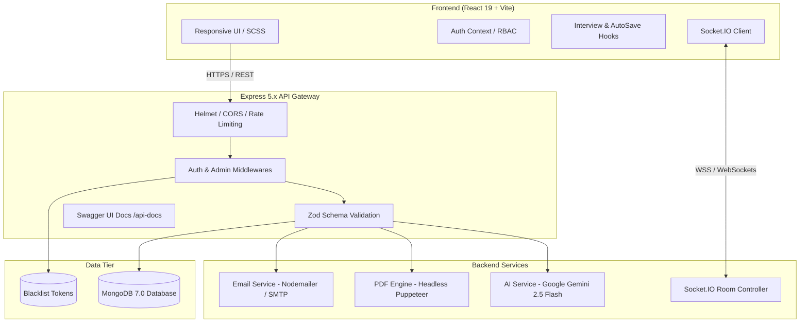

# 🎯 YT-GENAI — AI-Powered Interview Preparation & Assessment Platform

<div align="center">

[](https://react.dev/)
[](https://nodejs.org/)
[](https://expressjs.com/)
[](https://www.mongodb.com/)
[](https://ai.google.dev/)
[](https://socket.io/)
[](https://www.docker.com/)
[](https://opensource.org/licenses/ISC)

<p align="center">
  <strong>An end-to-end intelligent interview readiness platform that transforms resume parsing, job description analysis, track-specific mock simulations, real-time feedback scoring, ATS resume building, and peer collaboration into an interactive, high-impact preparation experience.</strong>
</p>

[Explore Features](#-key-features) • [System Architecture](#-system-architecture) • [Getting Started](#-getting-started) • [API Documentation](#-api-endpoints-reference) • [Docker Deployment](#-docker-deployment)

</div>

---

## 📌 Table of Contents

- [Overview](#-overview)
- [Key Features](#-key-features)
- [System Architecture](#-system-architecture)
- [Tech Stack](#-tech-stack)
- [Project Structure](#-project-structure)
- [Environment Variables](#-environment-variables)
- [Getting Started](#-getting-started)
  - [Prerequisites](#prerequisites)
  - [Option 1: Docker Compose (Quickest)](#option-1-docker-compose-recommended)
  - [Option 2: Manual Local Setup](#option-2-manual-local-setup)
- [API Endpoints Reference](#-api-endpoints-reference)
- [Real-Time WebSocket Events](#-real-time-websocket-events)
- [Admin Panel & Role Management](#-admin-panel--role-management)
- [Security & Performance Optimizations](#-security--performance-optimizations)
- [Troubleshooting & FAQs](#-troubleshooting--faqs)
- [Roadmap](#-roadmap)
- [Contributing](#-contributing)
- [License](#-license)

---

## 💡 Overview

Preparing for technical interviews can be overwhelming due to generic question banks, lack of personalized feedback, and mismatched resume keywords. **YT-GENAI** bridges this gap by combining state-of-the-art Generative AI (**Google Gemini 2.5 Flash**), automated ATS resume synthesis (**Puppeteer**), real-time collaborative sockets (**Socket.IO**), and multi-track interview evaluation rubrics into a single unified platform.

---

## ✨ Key Features

### 🤖 1. AI-Powered Interview Preparation Roadmap
- **Multimodal Candidate Profiling**: Upload your PDF resume, specify your background, and input target Job Descriptions (JD).
- **Match Score & Skill Gap Matrix**: Calculates candidate compatibility percentage (0–100%) and highlights missing competencies tagged by severity (`low`, `medium`, `high`).
- **Tailored Question Bank**: Produces technical and behavioral questions (aligned with STAR methodology) complete with interviewer intentions and suggested model answers.
- **Day-Wise Preparation Plan**: Automatically creates actionable, day-by-day study schedules tailored to your target interview date.

### 🎭 2. Track-Specific Mock Interview Simulator
- **Dynamic Track Selection**: Practice specifically across **Data Structures & Algorithms (DSA)**, **MERN Full Stack**, or **Core CS Fundamentals** (OS, DBMS, OOPs, SQL).
- **5-Pillar Evaluation Rubric**: AI scores answers (0–10) across:
  - 🎯 **Clarity**
  - 🏗️ **Structure**
  - 🔍 **Depth**
  - ⚙️ **Technical Accuracy**
  - 🗣️ **Communication**
- **Actionable Feedback**: Instant breakdown of what you did well, an **Ideal Answer**, and the **Top 3 Missing Points**.
- **Auto-Save & Session Replay**: Autosaves question responses in real-time, allowing candidates to review and replay past performance.

### 📄 3. ATS-Optimized Resume Tailoring & PDF Generation
- **Job-Targeted Re-Engineering**: Re-writes resume experience and summaries aligned directly to job keywords to bypass Applicant Tracking Systems.
- **Headless PDF Rendering**: Converts dynamic, styled HTML templates to pixel-perfect A4 PDFs on the server side using **Puppeteer**.

### 👥 4. Real-Time Collaborative Practice Rooms
- **Instant Room Creation**: Generate unique 6-character room codes for mock interview pairing.
- **Bi-Directional Sockets**: Real-time peer-to-peer messaging, question sharing, and live participant tracking powered by **Socket.IO**.

### 📊 5. Performance Analytics & Insights
- Comprehensive visual dashboards detailing mock interview completion rates, average rubric metrics, and personalized AI coach suggestions for next improvements.

### 🛡️ 6. Enterprise-Grade Authentication & Admin Panel
- **Secure Auth**: JWT stored in HTTP-only cookies, token blacklisting upon logout, and bcrypt password hashing with client-side strength indicators.
- **Email Verification & Account Recovery**: Automated OTP and reset links delivered via **Nodemailer / SMTP**.
- **Role-Based Access Control (RBAC)**: Dedicated `/admin` dashboard with user management, pagination, role upgrading/downgrading (`user` ↔ `admin`), and platform statistics.

### 🎨 7. Modern UI/UX
- Built on **React 19** with **SASS** design tokens, dark/light theme switching, interactive notification center, and toast feedback.

---

## 🏗️ System Architecture



---

## 🛠️ Tech Stack

| Domain | Technology | Description |
| :--- | :--- | :--- |
| **Frontend Framework** | React 19 (`react`, `react-dom`) | Modern component hierarchy with fast virtual DOM |
| **Routing** | React Router 7 (`react-router`, `react-router-dom`) | Client-side declarative routing & protected layouts |
| **Build & Styling** | Vite 8 + SASS (`sass`) | Next-generation frontend tooling and modular SCSS styles |
| **Realtime Client** | Socket.IO Client (`socket.io-client`) | Bidirectional WebSocket communication for collaborative rooms |
| **Notifications** | React Hot Toast (`react-hot-toast`) | Lightweight, responsive UI notifications |
| **Backend Framework** | Node.js + Express 5 (`express`) | Fast, unopinionated REST API runtime |
| **Database & ODM** | MongoDB + Mongoose 9 (`mongoose`) | Schematized NoSQL persistence for users, reports, and sessions |
| **Generative AI** | Google GenAI SDK (`@google/genai`) | Gemini 2.5 Flash for report synthesis & answer evaluations |
| **Validation** | Zod (`zod`, `zod-to-json-schema`) | Strict runtime schema parsing and OpenAPI JSON-schema exports |
| **PDF Engine** | Puppeteer (`puppeteer`) + PDF Parse | Server-side resume parsing and print-perfect PDF generation |
| **Security & Auth** | JWT, BcryptJS, Helmet, Express Rate Limit | Token authentication, password hashing, CSP headers, rate protection |
| **Email Delivery** | Nodemailer (`nodemailer`) | Transporter for verification codes and password recovery |
| **API Documentation** | Swagger UI (`swagger-ui-express`, `swagger-jsdoc`)| Interactive API explorer accessible at `/api-docs` |
| **DevOps & Containers**| Docker & Docker Compose | Containerized multi-service configuration |

---

## 📂 Project Structure

```text
YT-GENAI/
├── BACKEND/
│   ├── src/
│   │   ├── config/              # Database & environment variables validation
│   │   │   ├── database.js
│   │   │   └── env.js
│   │   ├── controllers/         # Request handlers
│   │   │   ├── admin.controller.js
│   │   │   ├── auth.controller.js
│   │   │   ├── interview.controller.js
│   │   │   └── interviewSession.controller.js
│   │   ├── docs/                # OpenAPI / Swagger definitions
│   │   │   └── swagger.js
│   │   ├── middlewares/         # Auth, RBAC, file upload & validation middlewares
│   │   │   ├── admin.middleware.js
│   │   │   ├── auth.middleware.js
│   │   │   ├── file.middleware.js
│   │   │   └── validateMiddleware.js
│   │   ├── models/              # Mongoose data models
│   │   │   ├── blacklist.model.js
│   │   │   ├── interviewReport.model.js
│   │   │   ├── interviewSession.model.js
│   │   │   └── user.model.js
│   │   ├── routes/              # Express API route declarations
│   │   │   ├── admin.routes.js
│   │   │   ├── auth.routes.js
│   │   │   ├── interview.routes.js
│   │   │   └── interviewSession.routes.js
│   │   ├── schemas/             # Zod input verification schemas
│   │   │   ├── authSchemas.js
│   │   │   └── interviewSchemas.js
│   │   ├── services/            # Gemini AI & Nodemailer business logic
│   │   │   ├── ai.service.js
│   │   │   └── email.service.js
│   │   └── app.js               # Express application initialization
│   ├── Dockerfile               # Backend container configuration
│   ├── package.json
│   └── server.js                # HTTP + Socket.IO server entry point
│
├── FRONTEND/
│   ├── src/
│   │   ├── api/                 # Axios HTTP clients (Auth, Admin, Interview)
│   │   │   ├── admin.api.js
│   │   │   └── client.js
│   │   ├── components/          # Reusable UI (Navbar, ErrorBoundary, NotificationCenter)
│   │   ├── features/
│   │   │   ├── admin/           # Admin Dashboard & user management
│   │   │   ├── auth/            # Auth pages (Login, Register, OTP, Reset) & Context
│   │   │   └── interviews/      # Interview Dashboard, Session, Analytics & Collaboration
│   │   ├── app.route.jsx        # App routes & protected layouts
│   │   ├── App.jsx
│   │   └── main.jsx
│   ├── Dockerfile               # Frontend multi-stage Nginx container
│   ├── package.json
│   └── vite.config.js
│
├── docker-compose.yml           # Multi-container orchestration (Mongo, Backend, Frontend)
├── .env.example                 # Environment variables template
└── README.md                    # Project documentation
```

---

## ⚙️ Environment Variables

### Backend Configuration (`BACKEND/.env`)

| Variable | Required | Default | Description |
| :--- | :---: | :--- | :--- |
| `PORT` | No | `3000` | Port for the Express server to listen on |
| `NODE_ENV` | No | `development` | Runtime environment (`development`, `production`, `test`) |
| `MONGO_URI` | **Yes** | — | MongoDB connection connection string (e.g. `mongodb://localhost:27017/yt-genai`) |
| `JWT_SECRET` | **Yes** | — | Secret key used to sign and verify JWT authentication tokens (min 8 chars) |
| `GOOGLE_GENAI_API_KEY`| **Yes** | — | Google AI Studio API key for Gemini 2.5 Flash |
| `FRONTEND_URL` | No | `http://localhost:5173` | Client URL for CORS whitelist |
| `SMTP_HOST` | No | `smtp.ethereal.email` | SMTP server host for sending emails |
| `SMTP_PORT` | No | `587` | SMTP port (`587` for TLS / `465` for SSL) |
| `SMTP_SECURE` | No | `false` | `true` for 465, `false` for other ports |
| `SMTP_USER` | No | `user@example.com` | SMTP authentication username / email |
| `SMTP_PASS` | No | `password` | SMTP authentication password / App password |
| `SMTP_FROM` | No | `noreply@ytgenai.com`| Sender email address for automated mailers |

### Frontend Configuration (`FRONTEND/.env`)

| Variable | Required | Default | Description |
| :--- | :---: | :--- | :--- |
| `VITE_API_URL` | No | `http://localhost:3000` | Base URL pointing to the Backend API |

---

## 🚀 Getting Started

### Prerequisites
Make sure you have the following installed on your machine:
- **Node.js** (v18+ recommended) & **npm**
- **MongoDB** (v6+ running locally or a MongoDB Atlas URI)
- **Docker & Docker Compose** *(optional, for containerized run)*
- **Google Gemini API Key** ([Get one here](https://aistudio.google.com/))

---

### Option 1: Docker Compose (Recommended)

Run the entire stack (MongoDB, Backend, and Frontend) with a single command:

1. **Clone the repository:**
   ```bash
   git clone https://github.com/your-username/YT-GENAI.git
   cd YT-GENAI
   ```

2. **Configure root environment file:**
   ```bash
   cp .env.example .env
   ```
   *Edit `.env` and set your `GOOGLE_GENAI_API_KEY` and optional SMTP credentials.*

3. **Build and start services:**
   ```bash
   docker-compose up -d --build
   ```

4. **Access the application:**
   - 🌐 **Frontend Application**: `http://localhost`
   - 🚀 **Backend API**: `http://localhost:3000`
   - 📚 **Swagger API Documentation**: `http://localhost:3000/api-docs`

5. **Stop containers:**
   ```bash
   docker-compose down
   ```

---

### Option 2: Manual Local Setup

#### Step 1: Start MongoDB
Ensure MongoDB is running locally on port `27017` or prepare your cloud MongoDB Atlas connection URI.

#### Step 2: Configure & Run Backend
```bash
cd BACKEND

# 1. Install dependencies
npm install

# 2. Create and configure .env file
cp ../.env.example .env
# Make sure MONGO_URI, JWT_SECRET, and GOOGLE_GENAI_API_KEY are configured

# 3. Start development server
npm run dev
```
*Backend runs on `http://localhost:3000` with Swagger docs at `http://localhost:3000/api-docs`.*

#### Step 3: Configure & Run Frontend
```bash
# Open a new terminal
cd FRONTEND

# 1. Install dependencies
npm install

# 2. Start Vite dev server
npm run dev
```
*Frontend runs on `http://localhost:5173`.*

---

## 📖 API Endpoints Reference

### 🔐 Authentication (`/api/auth`)
| Method | Endpoint | Access | Description |
| :--- | :--- | :---: | :--- |
| `POST` | `/api/auth/register` | Public | Register new user account with validation |
| `POST` | `/api/auth/login` | Public | Authenticate user & issue HTTP-only JWT |
| `GET` | `/api/auth/logout` | Public | Invalidate session & blacklist current token |
| `GET` | `/api/auth/get-me` | Private | Retrieve logged-in user profile & role |
| `POST` | `/api/auth/verify-email` | Public | Verify user email with verification token |
| `POST` | `/api/auth/resend-verification` | Private | Request new verification email |
| `POST` | `/api/auth/forgot-password` | Public | Send password reset token to email |
| `POST` | `/api/auth/reset-password` | Public | Reset password using valid reset token |

### 🎯 Interview & Reports (`/api/interview`)
| Method | Endpoint | Access | Description |
| :--- | :--- | :---: | :--- |
| `POST` | `/api/interview/` | Private | Upload resume (PDF) + JD to generate comprehensive AI report |
| `GET` | `/api/interview/` | Private | Fetch all generated interview reports for current user |
| `GET` | `/api/interview/report/:interviewId` | Private | Fetch specific interview report by ID |
| `POST` | `/api/interview/resume/pdf/:interviewReportId` | Private | Synthesize and download ATS-optimized PDF resume |

### 🎭 Mock Interview Sessions (`/api/interview/session`)
| Method | Endpoint | Access | Description |
| :--- | :--- | :---: | :--- |
| `POST` | `/api/interview/session/start` | Private | Start interactive mock interview session for track (`DSA`, `MERN`, `CORE`) |
| `POST` | `/api/interview/session/submit-answer` | Private | Submit answer, receive 5-pillar rubric score & AI feedback |
| `POST` | `/api/interview/session/update-progress`| Private | Autosave current question progress and draft answers |
| `GET` | `/api/interview/session/` | Private | List all past mock interview sessions |
| `GET` | `/api/interview/session/:sessionId` | Private | Retrieve full session breakdown and replay data |

### 👑 Admin Management (`/api/admin`)
| Method | Endpoint | Access | Description |
| :--- | :--- | :---: | :--- |
| `GET` | `/api/admin/dashboard` | Admin Only | Get system-wide metrics (users, reports, active sessions) |
| `GET` | `/api/admin/users` | Admin Only | Get paginated list of all registered users |
| `PATCH`| `/api/admin/users/:userId/role` | Admin Only | Update user role (`user` ↔ `admin`) |
| `DELETE`| `/api/admin/users/:userId` | Admin Only | Delete user and cascade delete related data |

> 💡 **Tip:** Explore and test all endpoints interactively at `http://localhost:3000/api-docs`.

---

## ⚡ Real-Time WebSocket Events

The platform includes a built-in WebSocket room server powered by **Socket.IO** for live collaborative peer interview sessions:

| Event Name | Direction | Payload | Description |
| :--- | :---: | :--- | :--- |
| `create-room` | Client ➔ Server | `{ username }` | Host initializes a new room; server generates 6-character room code |
| `room-created`| Server ➔ Client | `{ roomCode }` | Emitted back to host confirming room code |
| `join-room` | Client ➔ Server | `{ roomCode, username }` | Participant joins existing room code |
| `room-joined` | Server ➔ Client | `{ room }` | Sends room metadata & history to joining user |
| `user-joined` | Server ➔ Room | `{ username, participants }` | Broadcasts new user arrival to all room members |
| `send-message`| Client ➔ Server | `{ roomCode, username, text }` | Sends chat or answer draft to room members |
| `new-message` | Server ➔ Room | `{ username, text, timestamp }`| Broadcasts new message to all room participants |
| `room-error` | Server ➔ Client | `{ message }` | Triggered if invalid room code is provided |

---

## 👑 Admin Panel & Role Management

YT-GENAI includes a built-in Role-Based Access Control (RBAC) system.

### How to promote a user to Admin:
1. Register an account through the UI or API.
2. Open your MongoDB shell or MongoDB Compass and run:
   ```javascript
   use yt-genai
   db.users.updateOne(
     { email: "your-email@example.com" },
     { $set: { role: "admin" } }
   )
   ```
3. Log out and log back in. The **Admin Panel** link will now appear in your navigation bar (`/admin`), providing access to:
   - System metrics overview (total users, total reports generated, total mock sessions).
   - Paginated user list with role toggle buttons.
   - User account deletion.

---

## 🔒 Security & Performance Optimizations

- **Defensive HTTP Headers**: Powered by `helmet` to mitigate XSS, clickjacking, and MIME sniffing attacks.
- **Granular Rate Limiting**: Separate buckets for auth (`500 req / 15 min`), interview generation (`2000 req / 15 min`), and general API traffic (`5000 req / 15 min`).
- **Resilient AI Calling**: Multi-retry mechanisms (3 attempts with exponential delay) on all Google Gemini API interactions with fallback defaults to prevent server downtime.
- **Headless Browser Sandboxing**: Puppeteer configured with `--no-sandbox` flags optimized for both bare-metal and containerized environments.
- **Token Blacklisting**: Revoked JWTs are stored in a dedicated TTL-indexed MongoDB collection to ensure immediate invalidation upon logout.

---

## ❓ Troubleshooting & FAQs

<details>
<summary><strong>1. Error: "GOOGLE_GENAI_API_KEY is required"</strong></summary>

Ensure you have created a `.env` file in the `BACKEND` directory containing a valid Google Gemini API key:
```env
GOOGLE_GENAI_API_KEY=AIzaSy...
```
You can generate a free key at [Google AI Studio](https://aistudio.google.com/).
</details>

<details>
<summary><strong>2. Puppeteer fails to generate PDF inside Docker</strong></summary>

The backend Dockerfile is configured with Debian Chromium dependencies. If you're building a custom image, ensure `--no-sandbox` flags and `PUPPETEER_EXECUTABLE_PATH` are properly set.
</details>

<details>
<summary><strong>3. CORS errors when connecting frontend to backend</strong></summary>

Verify that your backend `.env` includes `FRONTEND_URL=http://localhost:5173` (or your production domain). By default, `app.js` permits requests from `http://localhost:5173`, `http://localhost:5174`, and the configured `FRONTEND_URL`.
</details>

<details>
<summary><strong>4. Emails are not sending during registration / password reset</strong></summary>

By default, the backend falls back to Ethereal email simulation if SMTP credentials are not configured. To send real emails, supply your Gmail App Password or SendGrid credentials in `BACKEND/.env`:
```env
SMTP_HOST=smtp.gmail.com
SMTP_PORT=587
SMTP_USER=your_email@gmail.com
SMTP_PASS=your_16_char_google_app_password
```
</details>

---

## 🗺️ Roadmap

- [x] Multi-track Mock Interviews (DSA, MERN, Core CS)
- [x] 5-Pillar Rubric Scoring with Gemini 2.5 Flash
- [x] ATS Resume Tailoring & Server-Side PDF Download
- [x] Real-time Collaborative Practice Rooms via WebSockets
- [x] Interactive Admin Control Center & RBAC
- [ ] 🎙️ Voice-to-Text Speech Mock Interviews (Web Speech API)
- [ ] 💻 In-Browser Interactive Code Editor / Sandbox (Monaco Editor)
- [ ] 📹 Video AI Mock Interviewer with Facial / Confidence Analysis
- [ ] 📱 Mobile Application (React Native / Flutter)

---

## 🤝 Contributing

Contributions are what make the open-source community an amazing place to learn, inspire, and create. Any contributions you make are **greatly appreciated**!

1. **Fork the Project**
2. **Create your Feature Branch**: `git checkout -b feature/AmazingFeature`
3. **Commit your Changes**: `git commit -m 'feat: Add some AmazingFeature'`
4. **Push to the Branch**: `git push origin feature/AmazingFeature`
5. **Open a Pull Request**

---

## 📄 License

Distributed under the **ISC License**. See `package.json` for more information.

---

<div align="center">
  <sub>Built with ❤️ for aspiring engineers and developers aiming to ace their technical interviews.</sub>
</div>
